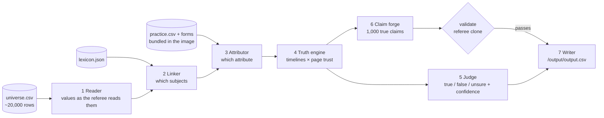

# Architecture

The whole system is `polygraph.pipeline.run(rows, lexicon, bundle) -> Result`. Docker (`polygraph/run.py`), the dev loop (`scripts/eval.py`) and the API (`server/app.py`) all call it.

## The idea

**Every row states facts.** A fact is (subject, attribute, value), for example (Hooly Jules, programming_languages, 14 languages).

**Each fact's value changes over the year like a staircase.** Lies come in three kinds:
- **invented** values, never true (~42% of lies);
- **stale** values, true earlier (~29%);
- **premature** values, true only later (~17%).

Whole pages lie together, and hedges ("I have been told") mark `unsure`. So we rebuild each fact's staircase from all 20k rows, weight every page by how trustworthy it proves to be, and judge each row against the staircases.

## Modules and status

| Module | Job | Owner | Status |
| --- | --- | --- | --- |
| `model.py` | Shared types: Row, ValueSpan, Fact, Step, Verdict, Claim | — | done |
| `lexicon.py` | Names, aliases, attributes, events | — | done |
| `tables.py` | Read input, write output atomically | — | done |
| `reader.py` | Value parser (clone of `contracts/value-forms.md`) | engine | **stub** (Phase 1) |
| `linker.py` | Subjects in a sentence, with page context for "It"/"He" | engine | done (v1) |
| `attributor.py` | Value → attribute classifier trained on practice forms | engine | **stub** (Phase 1) |
| `kb.py` | Timelines (staircases) + `KB.from_gold` | engine | done (v1) |
| `truth.py` | Truth discovery: DP staircase fit × page trust | engine | baseline (Phase 2) |
| `judge.py` | Fact status → label + confidence; runtime-trained meta-model | engine | baseline rules (Phase 2) |
| `render.py` | Value → text exactly as the referee reads it | forge | done (v1) |
| `forge.py` | Candidates of the 5 types → rank → 1,000 | forge | baseline, all 5 types |
| `validate.py` | Referee clone for claims | forge | structural checks; text checks pending reader |
| `trace.py` | Trace JSON for the frontend | — | done |
| `run.py` | Docker entrypoint: safe output first, then full; SIGTERM-safe | engine | done |

## Scores today (`python scripts/eval.py`)

| What | Number |
| --- | --- |
| Labels, baseline (all `true`) | 0.853 exact on the hidden fifth |
| Claims | 1,000; the format checks pass (`scripts/run_local.py`) |
| Gold-extraction judge, rules only | 0.663, worse than all-true until the Phase 2 truth engine lands |
